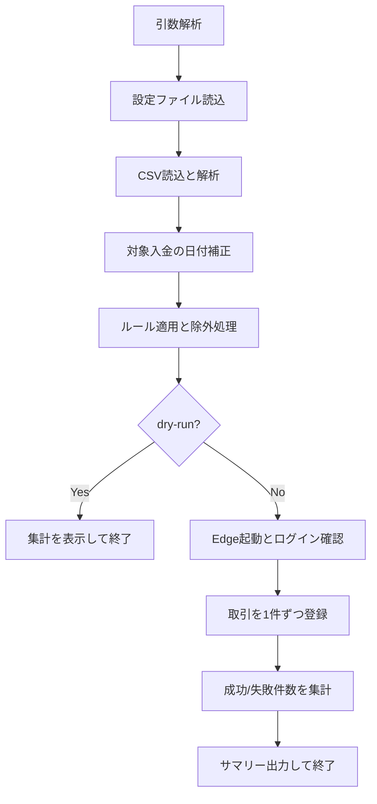

# 設計書

## 概要

### 背景・目的

背景：PayPay の利用明細を Money Forward ME に手入力する負担が大きい。

目的：PayPay 利用明細 CSV を読み込み、仕訳ルールを適用して Money Forward ME に登録する処理を自動化し、登録にかかる時間を短縮する。

### 機能一覧

- PayPay 利用明細 CSV を読み込み、取引データを解析する。
- 取引番号のプレフィックスによる除外とカテゴリの対応付けを、設定ファイルで指定できる。
- 同じルール配列で、カテゴリ登録と振替登録を設定できる。
- 特定の入金に限り、固定ルールに基づいて Money Forward に登録する取引日を 30 日後に補正する。
- Playwright の永続プロファイルを利用し、初回ログイン後もログイン状態を引き継いで実行できる。
- dry-run モードでは Money Forward に登録せず、件数だけ確認できる。
- 日付を入力した後、保存前に datepicker を閉じる処理を試みる。UI の重なりによる保存失敗リスクを軽減する。
- 登録に失敗した場合にスクリーンショットを保存できる。

## 入力

### コマンドライン引数

| 引数 | 必須 | 説明 |
| ---- | ---- | ---- |
| `--csv=<path>` | 必須 | PayPay 利用明細 CSV ファイルパス |
| `--config=<path>` | 任意 | 設定 JSON ファイルパス（既定値: config.json） |
| `--headless` | 任意 | Edge をヘッドレスモードで起動する |
| `--dry-run` | 任意 | 解析とフィルタのみ実行し、MF へ登録しない |
| `--keep-open` | 任意 | 終了時にブラウザーを閉じず、Enter キーが押されるまで待機する（ヘッドレスモードでは無効） |

補足：`--csv` が指定されていない場合は、終了コード 1 で終了する。

### 設定 JSON

| 項目 | 内容 |
| ---- | ---- |
| テンプレート | config_sample.json |
| ユーザー設定ファイル名 | config.json（任意のパス指定も可） |
| 形式 | JSON |
| エンコーディング | UTF-8 / UTF-8 BOM |

設定項目

| キー名 | データ型 | 説明 |
| ---- | ---- | ---- |
| `mfAccount` | `string` | Money Forward ME で使用する口座名 |
| `excludePrefixes` | `string[]` | 取引番号が指定したプレフィックスで始まる場合に除外 |
| `mappingRules` | `object[]` | 取引先のキーワードに応じてカテゴリを割り当てるルール、または振替登録ルール |
| `categoryMap` | `object` | 中カテゴリ名から大カテゴリ名への対応 |
| `duplicateDetection.backend` | `string` | `local` または `gcloud` |
| `duplicateDetection.databaseId` | `string` | Firestore の DB ID（gcloud 使用時。既定値は `(default)`） |
| `duplicateDetection.localStorePath` | `string` | local バックエンドの重複履歴 JSON の保存先。相対パスは設定ファイルのあるディレクトリを基準に解決する（既定値は `logs/processed.json`） |
| `gcloudCredentialsPath` | `string` | gcloud バックエンドで使用するサービスアカウント JSON のパス（必須）。相対パスは設定ファイルのあるディレクトリを基準に解決する |
| `advanced.screenshotOnError` | `boolean` | 登録失敗時にスクリーンショットを保存するかどうか |
| `advanced.includeUiCloseDiagnosticsOnError` | `boolean` | 登録失敗時に datepicker を閉じる処理の診断情報を出力するかどうか（既定値は `false`） |

`mappingRules` のスキーマ:

| キー名 | データ型 | 必須 | 説明 |
| ---- | ---- | ---- | ---- |
| `keyword` | `string` | 必須 | `取引先` に対する照合文字列 |
| `matchMode` | `string` | 任意 | `contains`、`starts_with`、`regex`。既定値は `contains` |
| `direction` | `string` | 任意 | `expense`、`income`、`any`。既定値は `any` |
| `priority` | `number` | 任意 | 数値が大きいルールを優先 |
| `category` | `string` | 条件付き | 通常のカテゴリ登録ルールで使う中カテゴリ名 |
| `isTransfer` | `boolean` | 条件付き | `true` の場合はカテゴリ登録ではなく振替登録として扱う |
| `transferAccount` | `string` | 条件付き | 振替相手の口座名。`isTransfer=true` の場合に必須 |

補足：

- `category` と `isTransfer=true` は同時に指定しない。
- `category` を指定したルールは、通常の入出金カテゴリ登録として扱う。
- `isTransfer=true` のルールは、カテゴリ登録ではなく振替登録として扱う。
- 同一取引に複数のルールが一致した場合は、`priority` の高い順に評価する。
- `priority` が同じ場合は、`mappingRules` の記述順（上から）を優先する。
- `direction=expense` の振替ルールでは、PayPay を振替元、`transferAccount` を振替先として登録する。
- `direction=income` の振替ルールでは、`transferAccount` を振替元、PayPay を振替先として登録する。

#### パス解決

`duplicateDetection.localStorePath` と `gcloudCredentialsPath` に相対パスを指定した場合は、設定ファイルが置かれたディレクトリを基準に解決する。
例えば、設定ファイルが `/workspace/config.json` の場合：

- `logs/processed.json` → `/workspace/logs/processed.json`
- `./secrets/paypay2mf-credentials.json` → `/workspace/secrets/paypay2mf-credentials.json`
- `/tmp/processed.json` → `/tmp/processed.json`（絶対パスはそのまま使用）

```json
{
    "mfAccount": "PayPay",
    "excludePrefixes": ["PPCD_A_"],
    "mappingRules": [
        {
            "keyword": "Seven",
            "category": "Food",
            "matchMode": "contains",
            "direction": "expense",
            "priority": 100
        },
        {
            "keyword": "PayPayポイント運用",
            "isTransfer": true,
            "transferAccount": "PayPayポイント",
            "matchMode": "contains",
            "direction": "expense",
            "priority": 400
        }
    ],
    "categoryMap": {
        "Food": "Living"
    },
    "duplicateDetection": {
        "backend": "local",
        "databaseId": "(default)",
        "localStorePath": "logs/processed.json"
    },
    "gcloudCredentialsPath": "./secrets/paypay2mf-credentials.json",
    "advanced": {
        "screenshotOnError": true,
        "includeUiCloseDiagnosticsOnError": false
    }
}
```

### PayPay 利用明細 CSV

| 項目 | 内容 |
| ---- | ---- |
| 形式 | CSV |
| エンコーディング | UTF-8 / UTF-8 BOM |
| ヘッダー | 必須 |

主な列

| 列名 | 説明 |
| ---- | ---- |
| 取引日 | 日時（yyyy/MM/dd HH:mm:ss） |
| 取引先 | メモ生成とルール判定に使用 |
| 出金金額（円） | 支出金額 |
| 入金金額（円） | 収入金額 |
| 取引内容 | 取引内容テキスト |
| 取引番号 | 除外判定に使用 |
| 取引方法 | 重複判定の入力項目 |
| 支払い区分 | 重複判定の入力項目 |
| 利用者 | 重複判定の入力項目 |
| 海外出金金額 | メモ補足情報 |
| 通貨 | メモ補足情報 |

## 出力

### 標準出力

通常実行時は、登録結果のサマリーを標準出力に表示する。

- 成功: 登録成功件数
- 失敗: 登録失敗件数
- スキップ: 除外などにより登録対象外となった件数
- 除外: プレフィックス除外件数
- 重複: 重複検知でスキップした件数
- 解析失敗: CSV 解析失敗件数

dry-run モードでは、以下の件数を表示する。

- 合計
- 解析失敗
- 除外
- 重複
- 対象

### 生成ファイル

| パス | 説明 |
| ---- | ---- |
| `.paypay2mf-profile/` | Playwright の永続プロファイル（ログイン状態を保持） |
| `artifacts/` | 登録失敗時のスクリーンショット保存先 |
| `logs/processed.json` | local バックエンドの重複履歴（`row_fingerprints` 配列） |

## 実行方法

### セットアップ

```bash
npm ci
npx playwright install
```

### 初回ログイン（重要）

1. 初回は `--headless` を付けずに実行する。
2. ブラウザーは `.paypay2mf-profile` を使って起動する。
3. 表示されたブラウザーで Money Forward に手動ログインする。
4. 家計簿画面が表示されたら、ターミナルで Enter を押す。
5. 2 回目以降は保存済みプロファイルを再利用する。

補足：初回に `--headless` を付けて実行すると手動ログインできないため、エラーで終了する。

### コマンド例

```bash
node src/import-paypay-to-mfme.js --csv="C:\\path\\paypay.csv"
node src/import-paypay-to-mfme.js --csv="C:\\path\\paypay.csv" --dry-run
node src/import-paypay-to-mfme.js --csv="C:\\path\\paypay.csv" --headless
node src/import-paypay-to-mfme.js --csv="C:\\path\\paypay.csv" --config="C:\\path\\config.json"
npm run smoke:dry-run
```

## 想定実行環境

| 項目 | 内容 |
| ---- | ---- |
| OS | Windows 10 / Windows 11 |
| Node.js | 24 以上 |
| ブラウザー | Microsoft Edge（stable、最新版推奨） |
| ライブラリー | Playwright 1.59.1 以上、@google-cloud/firestore 8.5.0 以上 |

## 処理詳細

1. コマンドライン引数を解析する。
2. 設定 JSON と UI セレクター設定を読み込む。
3. PayPay 利用明細 CSV を読み込み、行単位で解析して取引データを生成する。
4. 次の条件をすべて満たす入金に限り、Money Forward に登録する取引日を 30 日後に補正する。
    - `取引内容` が `ポイント、残高の獲得`
    - `取引方法` が `PayPayポイント`
    - `取引先` が `ワイモバイル` と `Yahoo!ズバトク` のいずれでもない
5. ルールに基づいてカテゴリを設定し、取引番号のプレフィックスによる除外と重複検知を行う。
6. 振替ルールに一致する取引では、カテゴリの代わりに振替元と振替先を設定する。
7. dry-run が指定されている場合は、集計結果を表示して終了する（重複履歴は更新しない）。
8. ブラウザーを起動し、必要に応じてログイン完了を待つ。
9. 対象取引を 1 件ずつ Money Forward の手入力画面に登録する。
10. 通常ルールでは口座とカテゴリを指定し、振替ルールでは同じモーダルの「振替」タブで振替元と振替先を指定する。
11. 日付を入力した後、保存前に datepicker を閉じる処理を試みる。
12. 登録成功後に重複履歴を更新する。
13. 登録結果のサマリーを出力し、ブラウザーコンテキストを終了する。



補足：

- 重複判定には PayPay 利用明細 CSV の `取引日` を使う。日付補正後の値は使わない。

## ログ出力

### ログ出力概要

| 項目 | 内容 |
| ---- | ---- |
| 出力先 | 標準出力 / 標準エラー |
| 形式 | プレーンテキスト |

### 主な出力メッセージ例

```text
ドライランモード
合計=120
解析失敗=2
除外=15
重複=7
対象=96

成功=100
失敗=3
スキップ=24
除外=15
重複=9
解析失敗=2

[登録失敗] 行=23 取引先=Example Store エラー=Money Forwardの口座選択に指定口座が見つかりません: PayPay
[成果物] スクリーンショット=C:\path\to\artifacts\failed-row-23-XXXXXXXX.png
[UI診断] 行=23 closeSteps={"blurInput":{"ok":true,"error":null},"pressTab":{"ok":false,"error":"press failed"},"clickModalSafeArea":{"ok":true,"error":null},"waitDatepickerHidden":{"ok":false,"error":"wait failed"}}
```

補足：

- `advanced.includeUiCloseDiagnosticsOnError` が `true` で、datepicker のクローズ処理に
    失敗した場合に限り、`[UI診断]` を出力する。

## ライセンス

### 本プログラムのライセンス

MIT License

### 使用ライブラリーのライセンス

| ライブラリー名 | バージョン | ライセンス |
| ---- | ---- | ---- |
| Playwright | 1.59.1 以上 | Apache-2.0 |
| @google-cloud/firestore | 8.5.0 以上 | Apache-2.0 |

## 開発詳細

### 開発環境

| 項目 | 内容 |
| ---- | ---- |
| OS | Microsoft Windows 11 Home 10.0.26200 |
| ランタイム | Node.js v24.12.0 |
| 自動化基盤 | Playwright 1.59.1 |
| 対象ブラウザー | Microsoft Edge 147.0.3912.98 |
| エディター | Visual Studio Code 1.119.0 |

### プロジェクト構成（主要ファイル）

| ファイル | 説明 |
| ---- | ---- |
| `src/import-paypay-to-mfme.js` | CLI のエントリポイント（起動・画面操作・実行制御） |
| `src/import-core.js` | CSV の解析・変換・フィルタ処理などの純粋ロジック |
| `src/duplicate-detector.js` | 重複検知（local / gcloud バックエンド） |
| `src/mfme.config.json` | Money Forward UI のセレクターとタイムアウト設定 |
| `config_sample.json` | ユーザー設定のサンプル |

### 検証コマンド

```bash
npm ci
npm test
npm run lint:md
npm run test:gcloud:e2e
npm run smoke:dry-run
```

## 改訂履歴

| バージョン | 日付 | 内容 |
| ----- | ---------- | -------------- |
| 1.1.1 | 2026-05-31 | 不具合修正：振替保存時の datepicker 残留によるタイムアウトを修正 |
| 1.1.0 | 2026-05-10 | 振替も自動登録できる機能を追加<br>Node.js 24 対応 |
| 1.0.0 | 2026-05-06 | 初版作成 |
